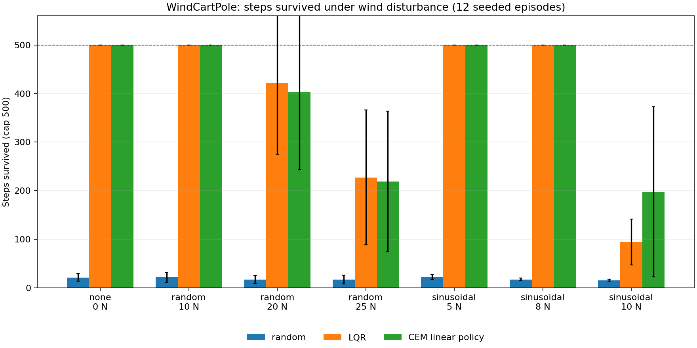

# WindCartPole (RL)

[](https://github.com/Dtunder/rl-cartpole-custom/actions/workflows/tests.yml)

WindCartPole is a Gymnasium CartPole environment with configurable external wind. It keeps the `WindCartPoleEnv` and `WindCartPole-v0` interface and supports `none`, `random`, and `sinusoidal` wind.

## Method

- **LQR baseline:** a discrete linear-quadratic regulator is calculated from the dynamics linearized around the upright state. Its continuous control signal selects one of the environment's two force actions.
- **Learning agent:** a four-weight linear threshold policy is tuned with the cross-entropy method (CEM), implemented in NumPy. CEM starts from the LQR weights and optimizes return over fixed seeded no-wind, random-wind, and sinusoidal-wind scenarios.
- **Evaluation:** each policy uses the same 12 episode seeds per condition. Episode return is the number of steps survived, capped at 500. The evaluation seed range is 23100–23111.

## Results



Measured with `python evaluate.py` on 2026-10-28. Values are mean steps survived ± population standard deviation across 12 seeded episodes (cap 500); the last column is the mean absolute pole angle over the episode, a measure of stabilisation quality. Full results: [`results/results.csv`](results/results.csv).

| Wind | Force (N) | Random | LQR | CEM linear policy | Mean abs. pole angle LQR / CEM (°) |
|---|---:|---:|---:|---:|---:|
| none | 0 | 21.3 ± 7.8 | 500.0 ± 0.0 | 500.0 ± 0.0 | 0.20 / 0.22 |
| random | 10 | 21.5 ± 10.2 | 500.0 ± 0.0 | 500.0 ± 0.0 | 0.58 / 0.68 |
| random | 20 | 17.0 ± 8.1 | 421.4 ± 146.1 | 403.2 ± 160.0 | 1.85 / 2.16 |
| random | 25 | 16.8 ± 9.1 | 227.4 ± 138.6 | 219.2 ± 144.5 | 3.00 / 3.06 |
| sinusoidal | 5 | 22.3 ± 5.2 | 500.0 ± 0.0 | 500.0 ± 0.0 | 0.93 / 0.94 |
| sinusoidal | 8 | 17.3 ± 3.0 | 500.0 ± 0.0 | 500.0 ± 0.0 | 1.67 / 1.66 |
| sinusoidal | 10 | 15.8 ± 2.4 | 94.2 ± 47.3 | 197.5 ± 175.0 | 3.97 / 3.88 |

**Reading the table**

- The actuator can only push with ±10 N (bang-bang). Sinusoidal wind with 10 N amplitude therefore sits exactly at the limit of controllability; above that the pole cannot be held by any controller, so stronger sinusoidal cases are deliberately not reported.
- Up to random 10 N and sinusoidal 8 N both LQR and the learned policy hold the pole for the full 500 steps; LQR keeps it slightly more upright (smaller mean angle) under random wind.
- Under strong random wind (20–25 N peak) both degrade similarly; LQR survives marginally longer.
- At the controllability limit (sinusoidal 10 N) the CEM policy, which was trained on disturbed scenarios, survives about twice as long as the LQR designed for the undisturbed model, at a large spread.

## Reproduce

```bash
python -m pip install numpy gymnasium matplotlib pytest
python -m pytest -q
python evaluate.py
```

`evaluate.py` retrains CEM with fixed seeds, then writes `results/results.csv` and `results/comparison.png`. Use `python evaluate.py --smoke` for the shorter CI path. On the recorded local run, CEM training alone took 3.8 seconds on CPU; total evaluation took 11.8 seconds.

## Limitations

The learned policy is a linear threshold policy and is optimized against a small, fixed set of simulated scenarios. Evaluation uses one 12-seed batch and the simulator's 500-step limit; the capped scores conceal differences in easy conditions. These results do not establish performance on physical hardware or under other disturbance models.
